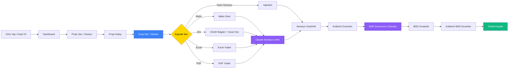

# QA Platform - Test Senaryo Akışı

## Akış Özeti

1. **Giriş / Kayıt** → Dashboard'a düşer
2. **Proje Seç / Oluştur** → Proje detayına girer
3. **Senaryo Grubu Seç / Oluştur** → Grup türü belirlenir (BUG, FEATURE, REGRESSION, SMOKE, INTEGRATION, E2E, PERFORMANCE, OTHER)
4. **Kaynak Seç** — 5 farklı yol:
   - **Hazır Senaryo**: Kullanıcı test senaryosunu yapıştırır (Claude üretmez)
   - **Metin Girişi**: Kullanıcı metin girer → Claude test senaryosu üretir
   - **Jira**: OAuth ile bağlanır → Issue key girer → Claude test senaryosu üretir
   - **Excel**: Dosya yükler → Claude test senaryosu üretir
   - **PDF**: Dosya yükler → Claude test senaryosu üretir
5. **Senaryo Gösterilir** → Kullanıcı düzenler
6. **BDD/Gherkin Dönüşümü** (Claude) → Kullanıcı BDD çıktısını düzenler
7. **Gruba Kaydet** — Senaryolar seçilen gruba kaydedilir

### Renk Kodları
- 🔵 **Mavi** — Gruplama adımı (senaryo grubu seçimi)
- 🟡 **Sarı** — Karar noktası (kaynak seçimi)
- 🟣 **Mor** — Claude'un çalıştığı adımlar
- 🟢 **Yeşil** — Kaydetme
